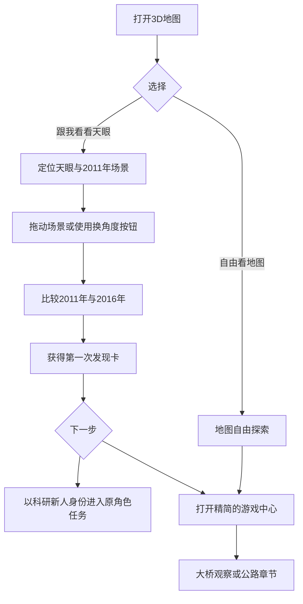

# 贵州3D交互地图游戏 V17 第一阶段交付说明

版本日期 2026年10月28日

## 本轮任务边界

本轮执行五阶段计划的第一阶段，**产品入口、新用户首次旅程、三款游戏导航结构和第一份可理解的学习记录**。基于V16完整工程修改，并非重做地图或宣称六条故事线已完成机制重构。

原项目 `assets/js/fast/role-adventure.js`、`assets/js/ux/pixel-truck.js` 和桥梁驾驶核心逻辑继续保留。下一阶段才会改造剧情依赖、科学模拟与任务判定，不应把本轮的入门导览视为正式科研验证。

## 本轮已经实现

| 修改对象 | 原先问题 | 现在行为 | 对应文件 |
|---|---|---|---|
| 首次打开 | 默认进入花江地图，缺少自动启动的新手路径 | 首次显示一张轻量入口卡，优先“跟我看看天眼”，也允许直接查看地图 | `assets/js/ux/v17-entry.js` |
| 探索入口 | 地图上多个浮动入口与游戏中心同时竞争注意 | 统一“开始探索／看地图／我的发现”三项主导航，并隐藏冗余浮动入口 | `assets/css/v17-entry.css` |
| 新手第一动作 | 新手不知道地图是否可以操作 | 让用户实际拖动3D场景，完成后才解锁下一步；提供键盘/触屏操作替代按钮 | `v17-entry.js` |
| 时间维度 | 年份功能与游戏入口缺少关联 | 引导用户查看2011年开工与2016年落成的两个时间状态，再生成发现卡 | `v17-entry.js` |
| 三游戏选择 | 长介绍、职业总数、任务总数造成预先负担 | 重排游戏中心，推荐天眼，花江大桥与贵州公路为次级入口 | `v17-entry.js`（覆盖Hub的展示层） |
| 成果访问 | JSON进度不适合普通玩家阅读 | 新增可阅读的“我的发现”面板，保留原游戏记录 | `v17-entry.js` |
| 返回与续存 | 进入游戏、退出、刷新后入口状态不清楚 | 引导进度本机自动保存，已完成首次引导者刷新后不会被重新打断 | `v17-entry.js` |
| 移动端 | 模型可能被下方文案卡遮住 | 为窄屏调整观察镜头、移动卡片与简化工具栏；测试320、390像素宽 | `v17-entry.css` |

## 第一次体验的连续路线

说明：引导的目的在于教会玩家理解基本地图操作与历史时间轴。仅完成地图操作不等于完成科研或社区调查。两个年份的历史事实与简化图形明确区分。

## 关键文案原则

- 入口只呈现一个推荐行动：“跟我看看天眼”。
- 每个阶段只显示当前动作：“转一转，看看山窝”“分别点击年份”。
- 前置条件未满足前禁用下一步，说明如何满足条件。
- 结束时用具体发现代替“恭喜通过”，结果写明“2011年开工，2016年落成”。
- 简化场景声明压缩到简短脚注。科学材料与访谈证据仍需要后续阶段单独核对。

## 测试记录

测试方式：通过Chromium对源代码内联加载后的等效HTML进行自动化检查，操作真实按钮与Canvas指针事件，不依赖外部地图服务。

| 场景 | 1440×900 | 390×844 | 320×700 |
|---|---|---|---|
| 首次引导显示 | 通过 | 通过 | 通过 |
| 未完成观察时禁止继续 | 通过 | 通过 | 通过 |
| 真实拖动Canvas解锁观察 | 通过 | 通过 | 通过 |
| 未切换2016年时禁止结束 | 通过 | 通过 | 通过 |
| 最终发现卡与游戏中心 | 通过 | 通过 | 通过 |
| 从游戏中心进入桥梁准备界面 | 通过 | 通过 | 通过 |
| 从游戏中心进入货车章节 | 通过 | 通过 | 通过 |
| 返回地图和宽度溢出检查 | 通过 | 通过 | 通过 |
| 脚本错误检查 | 0条 | 0条 | 0条 |

补充验证：1440宽窗口下，完成引导后再次加载不重复显示首次引导。390/320宽未在上述同一自动化脚本中执行刷新回归，以避免Chromium内联渲染资源占用导致的测试超时；本机状态读写逻辑仍需真机进行复核。

## 尚未解决的V16问题

- 天眼内部18个角色任务仍以读取卡片和预设答案为主，尚缺严格的证据依赖状态机。
- 两个时代的FAST内部模型仍是教学示意图，建设期没有完整的分期资产。
- 大桥仍是固定路线播放，货车仍以跟车动画为主，真实操作深度仍不足。
- 当前学习成果页尚以基础记录数量为主，未生成可回看的测量图、工程记录或居民关切卡。
- 源资料与任务对象尚未建立逐项可审计的材料来源和证据等级关联。
- 首次引导的视觉效果并非真实高程模型；这部分不构成三维实测场景。

## 后四步开发安排

| 阶段 | 工作重点 | 完成门槛 |
|---|---|---|
| 第二步 | 核心任务状态机与证据链；修复点击次数通关、失败恢复、即时反馈、存档 | 没看必要场景对象无法通关；刷新恢复局部操作；每关独立成果卡 |
| 第三步 | 天眼三角色双时代的完整因果故事线与科学互动 | 同一事件三角色有不同权能与成果；跨时代读取实际成果；科学示意符合事实 |
| 第四步 | 花江大桥及公路玩法重构；空间、资料与决策的统一 | 核心关卡必须利用场景观察；不能把跟车动画包装为自由驾驶 |
| 第五步 | 统一视觉/移动端/无障碍，田野证据审核，完整用户测试和可读的学习报告 | 零基础用户独立完成一条主线，能够说明依据、结果与下一步 |

## 运行说明

双击 `index.html` 以查看概念地图。若浏览器限制本地资源，可使用 `python -m http.server 8000` 在项目目录启动静态服务，再打开 `http://localhost:8000`。无需地图密钥即可体验概念模型。另提供单文件HTML用于离线演示。真实地图底座、公开高程和在线瓦片仍取决于相应服务或素材来源。
