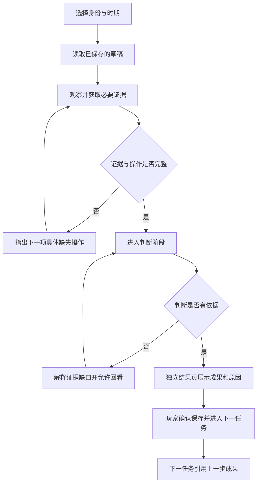

# 贵州3D交互地图游戏 · 五步优化计划 · 第二步实施与验收说明

**版本**：V18 · 第二步  
**改造基线**：V17 第一阶段完整工程  
**本阶段范围**：中国天眼任务状态机、证据与模拟操作的完成条件、结果反馈、局部草稿保存、任务衔接、移动端的当前任务呈现。  
**保留内容**：V17 首次进入和地图导航、三维地图、桥梁及公路游戏原有玩法和数据。

## 一、本阶段解决的问题

| 原来的问题 | V18 的实际修改 | 可核查的结果 |
| --- | --- | --- |
| 开局同时显示资料、模型、选择答案 | 在天眼任务中分离观察、判断、结果三个独立界面阶段 | 观察阶段不显示答案，判断阶段不再铺满资料卡 |
| 读取任意若干资料即可进入选择 | 各关建立必要证据清单，不以总阅读数代替关键知识 | 台址任务必须检查洼地、山地屏蔽和交通条件，并改变一次观察角度 |
| 资料阅读取代模拟操作 | 参数关必须提交有效校验；频谱关需对照两组波形；电磁关需切换至少两种情境 | 仅查看资料不能通过上述关卡 |
| 修改滑块后沿用旧的合格测量 | 滑块任一数值变化时撤销旧校验 | 再次提交校验前无法进入判断 |
| 查看资料数量改变干扰柱形 | 干扰柱形只根据模拟情境选择变化 | 点击证据卡不改变柱形高度 |
| 选对答案便直接跳入下一关 | 正确判断后停留在结果页，展示依据、成果与下一项工作 | 需自主点击“保存成果，继续下一项”才能推进 |
| 一旦中断便丢失阅读、校验和输入 | 将每关阅读、参数、情境切换、文本草稿、当前阶段持久化至本机浏览器 | 退出后重返相同角色时代，可恢复上次阶段 |
| 上一关只留一句泛化反馈 | 新关卡读取同一角色此前保存的证据和校验数据，生成接续提示 | 可看到上一步的具体记录和校验值 |
| 移动端全局地图导航覆盖游戏界面 | 在全屏任务、驾驶和像素游戏期间隐藏全局导航 | 390px 和 320px 窄屏不再出现导航覆盖 |
| 角色档案只有答题结果 | 档案展示证据名称、模拟参数、比较过的情境、个人说明与下一步用途 | 已完成工作可复查，而非只有通关数量 |
| 清空游戏记录不能清空任务草稿 | 游戏中心清空操作同步删除 `fastDrafts` | 不出现“清空后意外恢复旧草稿”的情况 |

## 二、任务运行机制

`collect` 为收集阶段，`decision` 为判断阶段，`feedback` 为结果阶段。只有用户在结果页点击“保存成果，继续下一项”时，才正式写入任务完成记录。结果页本身也会保存为草稿，因此退出或刷新不应该跳过结果解释。

任务状态保存在原有的 `guizhou-games-v16` 数据结构中，新增 `fastDrafts` 字段。新版本继续读取此前的已完成任务；若存在旧版已通关记录，不强制清空。

## 三、具体代码及可维护性

- `assets/js/fast/v18-task-flow.js`：新增阶段管理、必要证据规则、操作核验、草稿存取、反馈页及成果引用。
- `assets/css/v18-task-flow.css`：重排任务阶段的视觉层级；区分场景、当前任务与操作面板；修复地图导航在任务内叠盖。
- `assets/js/ux/game-hub-v16.js`：清空本地学习记录时同步清理未完成任务草稿。
- `index.html`：在原有脚本和样式之后引入 V18 规则与视觉模块，保留 V17 内容。

这一阶段采用叠加升级方式，尚未删除 `role-adventure.js` 中的全部旧版任务排版代码。第三、第五阶段应继续合并重复实现，减少新旧样式并存的维护成本。

## 四、测试与结果

本轮使用 Chromium 完成以下检查。

- **规则自动化测试**：三个角色、两个历史时期、共 18 项任务的必要证据、进入判断、结果页及记录写入流程全部通过。批量检查通过浏览器运行的 JavaScript 任务接口执行，不等同于 18 次人工逐按钮测试。
- **交互测试**：台址任务的证据与旋转门槛、错误选项不通关、正确答案停留反馈页；滑块变更后要求重新校验；公众文本为空时不能提交；查看证据不会使电磁柱形发生变化。
- **续存测试**：桌面浏览器完成一次任务至结果阶段后，以保存的浏览器数据重建页面并恢复阶段；已完成的关卡结果可供下一关调用。测试环境采用本地存储模拟以规避浏览器自动化沙箱的资源访问限制，真实电脑上的浏览器持久化仍需实际使用验证。
- **尺寸测试**：1440px、390px、320px 三档视口没有横向页面溢出、没有未捕获的页面脚本异常。
- **其他游戏回归**：游戏中心、大桥体验准备页、货车游戏、天眼退出与“我的发现”入口在桌面和手机视口均能正常打开。

已生成任务操作与结果页截图，作为视觉走查证据。不能据此宣称整个工程已完成专业可用性、真实手机设备或大规模公众学习效果验收。

## 五、明确尚未完成的事项

1. **真实科研操作的深度仍不足**。当前反射面、馈源与波形为教学概念模型，缺乏可验证的几何和物理仿真，不能代替科学观测训练。
2. **角色叙事还不够独立**。六条故事线虽然有独立题目和所需操作，尚未构建共享事件、角色权限和复杂的跨角色协商；这属于第三步。
3. **施工时代的三维模型仍偏完整**。2011 年画面保留了一部分现成装置的示意，尚未更换成分期建设模型；这属于第三步。
4. **桥梁与货车玩法未重构**。这一轮只验证入口和返回没有回归，实质性体验改造在第四步。
5. **移动端目前仍需滚动查看模型与证据区**。虽然主导航遮挡已修正，真正的单手、短操作路径和统一视觉系统仍需第五步进一步测试与迭代。
6. **教育目标尚未经过真实零基础用户测试**。应招募对FAST和贵州调研没有先验知识的玩家，进行独立上手、任务因果理解和知识迁移测试。

## 六、五步进度

| 阶段 | 范围 | 状态 |
| --- | --- | --- |
| 第一步 | 入口、新手地图观察、统一导航 | 已完成，V17 |
| **第二步** | **任务因果、证据门槛、反馈页、草稿续存** | **已完成核心代码与自动化回归，V18** |
| 第三步 | 天眼三角色双时代剧情、真实科学互动、共享事件 | 未开始 |
| 第四步 | 花江大桥及公路游戏核心玩法重构 | 未开始 |
| 第五步 | 统一视觉文案、无障碍与真实新手测评 | 未开始 |

**下一轮开发的输入**：以 V18 完整工程为基线，优先重做“科研人员 · 建设时代”三项任务的真实交互和可视因果链，再推广到另两种身份及运行时代。禁止把简单的必读资料数量增加当作科学互动完成。
