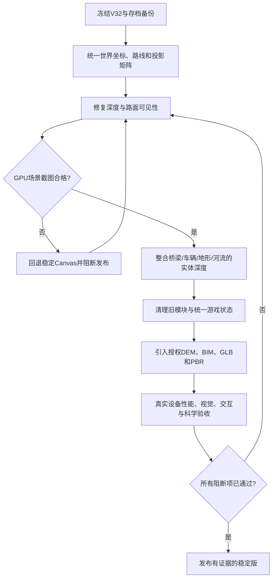

# 贵州3D交互地图 V32 全工程问题审计与系统性整改任务书

> **文件定位**　交付给产品、交互、科学内容、三维/渲染、前端、测试和数据制作人员的统一整改基线。仅审计与设计，不修改 V32 工程。
>
> **审计对象**　`贵州3D交互地图游戏_V32_高写实渲染管线_完整工程.zip`（当前工程）、V31压缩包（版本差异）、本轮用户提供的驾驶截图及既有V16—V32版本验收说明。对原工程解压后检查了HTML、35份CSS、36份JS、数据入口、工程配置及既有QA报告。
>
> **证据规则**　`C`为可从当前源码、配置、文件或截图直接确认的问题；`I`为基于代码的因果推断，必须用运行实验验证；`V`为尚未复现、必须通过实机或新用户测试排除的风险。截图属于直接视觉证据，但原因诊断仍需结合GPU深度附件验证。任何一个“C”不等同于所有机型均会发生。

## 0. 核心判断

目前问题已经表现为渲染架构、地理数据、游戏控制、UI和测试治理之间的系统性失配。**最严重的是V32的道路和地形使用了不同的深度映射，却被宣称处于同一深度缓冲；紧接着，GPU函数执行成功后Canvas道路立即被清空。**这解释了为什么用户看到驾驶舱和山体，却看不到正常连续的道路。其余诸如低精度资产、缺失DEM、复杂CSS叠加、旧游戏入口和固定时长任务控制，也使“继续添加特效”不能形成稳定的升级。

下一阶段暂停扩大场景、增加题目或付费模型生成，先完成可以直接复现的核心缺陷修复、正式测试和版本整合，再开展真实地形、BIM与PBR材质工作。

## 1. 用户截图中的直接现象

- **路面严重缺失**：驾驶舱仍显示车速、里程、方向控制，但挡风玻璃前被绿色地形占据，路面无法辨认，失去“驾驶”的主要视觉锚点。
- **空间关系不可信**：远处桥塔和索体可见，近处道路缺失。玩家无法判断车位于道路、边坡还是悬空位置。
- **状态提示错误**：画面出现“GPU 三维深度渲染 · 教学模型”标签，但GPU路径调用成功并不能证明路面像素正确，更不代表已达到高写实视觉精度。
- **HUD过载**：顶部标题、左侧章节、右侧镜头按钮、底部速度和虚拟控制同时占用视野。底部面板内部出现滚动条，驾驶时不应依靠滚动寻找主要操作。
- **学习与驾驶体验割裂**：道路不可见时，车速仍前进，用户无法根据地形做出速度或方向判断；任务提示依然照常出现。

截图的**直接视觉结论**为“道路呈现失败、操作界面遮挡明显”。以下根因将以代码、计算和后续GPU实测分别确认。

## 2. 根因证据链与定量核查

### 2.1 深度公式不一致

`assets/js/scene/webgl-terrain-v25.js` 第16—18行中的地形裁剪深度为：

```glsl
float z = dot(v, uForward);
gl_Position = vec4(screenX, screenY, z * 1.0001 - 35.0, z);
```

`assets/js/scene/v32-drive-world.js` 第44—46行中的道路裁剪深度为：

```glsl
float z = dot(v, uForward);
gl_Position = vec4(screenX, screenY, z * 1.00005 - 0.25, z);
```

两者在齐次除法后的NDC深度分别为 `1.0001 - 35/z` 和 `1.00005 - 0.25/z`。当两个表面的摄像机距离均约100场景单位时，地形深度为0.6501，道路深度为0.99755。WebGL常规深度测试认为更小的深度更靠前，于是**更远的地形也可能压过更近的道路**。这属于渲染合同错误，不是增加模型精细度能解决的问题。

### 2.2 丢失回退路径

`assets/js/scene/webgl-terrain-v25.js:190-196` 用 `driveWorld.render(...)` 的布尔结果设置 `driveReady`，随后 `assets/js/scene/engine.js:441` 只要认为GPU绘制成功就清除Canvas。`assets/css/v32-drive-world.css:2-3` 还将Canvas图层设置为透明。当前未对道路颜色附件、深度附件、实际可见包围框进行校验，因此“程序无异常”与“画面正确”被混淆。

### 2.3 净空数据计算能反证“仅仅是山体过高”的解释

审计脚本使用实际V32 `database.bundle.js`、`drive/route.js` 和 `geo/bridge-road-cut-v30.js`，对路线从0%至100%间隔2.5%的41个位置采样。未经修正的模拟地形中23处高度超过路线，加入V30的显示净空修正后，41个中心位置都低于道路29—720个场景单位。**这说明原始穿模确实存在，也说明V30的中心线净空修正已经改变了它。V32仍发生道路消失，必须检查深度公式、左右路肩净空和可见性判定。**

该计算采用CPU上的双线性高程近似，尚未逐像素复刻V32的双三次插值、噪声和GPU深度附件，因此不能证明整条三维路面已经没有几何交叉。实际发布应逐顶点、逐截面、逐帧复核。

### 2.4 版本回归证据

V31与V32压缩包的文件差异显示，V32在保留239个旧路径的基础上，修改了 `index.html`、`scene/engine.js`、`scene/webgl-terrain-v25.js`，增加 `scene/v32-drive-world.js` 等文件。问题可归入这一组新增GPU路径的高优先级回归范围。V32现有QA报告明确写明其**未完成真实WebGL2上下文、着色器GPU编译及硬件性能验证**。因此该版本不能按高写实验收完成版发布。

## 3. 问题严重程度与处理原则

| 等级 | 定义 | 典型问题 | 发布条件 |
|---|---|---|---|
| **P0 阻断** | 核心功能失效、结果错误或明显误导 | 道路消失、深度错误、原功能入口无响应 | 全部修复并复现验证前禁止作为正式版替换 |
| **P1 高优先** | 高概率破坏体验或造成长期技术债 | 多套任务冲突、真实数据缺失、模型结构失真 | 制定责任人和测试，在下一主版本修复 |
| **P2 计划优化** | 不直接阻断主流程但影响完整度 | 细节、无障碍、辅助反馈 | 纳入后续质量迭代 |

优先修正确性，再修体验流畅，随后进行科学内容与美术精度升级。严格区分程序化视觉效果、教学物理和真实地理/工程数据。

## 一、渲染失效与道路消失（必须先修）

| 编号 | 优先级/证据 | 问题与用户影响 | 定位依据 | 整改动作 | 验收标准 |
|---|---|---|---|---|---|
| R01 | P0/C | 道路和地形使用不同的裁剪深度常数，跨程序的深度值不可比较 | scene/v32-drive-world.js:44-46；scene/webgl-terrain-v25.js:16-18 | 统一透视投影矩阵及 near/far，所有材质使用同一深度规范；不在每个着色器里手写独立深度系数 | 道路与地形前后遮挡在连续行驶全程正确，GPU截图逐帧可核对 |
| R02 | P0/C | GPU绘制函数返回 true 就标记 driveReady，缺乏道路可见性条件 | scene/v32-drive-world.js:173-189；scene/webgl-terrain-v25.js:190-196 | 加入shader/program、缓冲、投影、可见包围盒、GL error 和关键场景渲染探针；失败才进入回退 | 把道路强制设为不可见时必须触发兼容道路显示或明确错误提示 |
| R03 | P0/C | 一旦 driveReady 成立即清空整个 Canvas 画面，失去原道路的保底层 | scene/engine.js:440-443 | 将 GPU 成功判定与 Canvas 隐藏绑定可见帧证据；增加渲染心跳和失败回退 | 模拟GPU通道输出透明/空画面时，用户仍能看见连续路面 |
| R04 | P0/C | CSS也把worldCanvas强制设为透明，形成第二套独立的隐藏逻辑 | css/v32-drive-world.css:2-3 | 整合 DOM 图层可见性到一个 RenderMode 状态机，不同时依赖样式和绘制分支 | 渲染模式切换时任一时刻恰有一个有效的路面主画面 |
| R05 | P0/C | GPU管线只做模拟接口检查，未进行真实着色器编译及GPU截图验收 | qa/v32/V32_verification_report.json；docs/V32_高写实三维管线与验收.md | 建立 WebGL2 真机支持矩阵与最小场景截图回归，未过关不得默认启用 | 至少指定桌面GPU和移动GPU运行截图、GPU错误日志、遮挡对照 |
| R06 | P0/I | 切入驾驶镜头后，渲染优先级从旧Canvas混合转到全GPU，旧交错机制被整体跳过 | scene/engine.js:440-445 | 明确分层：3D实体同一深度，HUD独立2D；任何3D对象不得依赖屏幕绘制顺序 | 道路、桥体、河面、地形、车体在一组统一遮挡测试中通过 |
| R07 | P0/C | 地形使用 near 常数35，水面35，GPU道路却使用0.25；摄影机近处深度失真 | scene/webgl-terrain-v25.js:16-18,145-147；scene/v32-drive-world.js:44-46 | 将投影变换封装为共享 GLSL/JS 矩阵库，进行一致性自动检查 | 测试自动解析/比对 shader projection hash，禁止不一致合并 |
| R08 | P0/V | 道路深度错误可能在不同视角、路段、DPR上表现为间歇性遮挡或路面闪现 | 用户截图；需GPU实测 | 针对驾驶、乘客、跟车、电影四种镜头进行0%、10%、25%、50%、75%、95%位置截图 | 所有24个组合的关键道路区域可见，按像素和深度附件双重核验 |
| R09 | P1/C | 路面GPU道路段独立由驾驶route构造，而地形由DEM网格及V30切坡规则构造 | scene/v32-drive-world.js:109-143；geo/bridge-road-cut-v30.js:13-30 | 统一道路坐标、法向和路基几何的世界空间基础资产 | 地形重建后计算每个道路截面的桥面净空及道路边界交集 |
| R10 | P1/C | 地形画面与驾驶场景的渲染模式由 body class、ready、active多方控制 | scene/webgl-terrain-v25.js:79,175-197；scene/engine.js:437-445 | 集中管理图层和状态，提供可查询的 renderHealth 诊断信息 | 开发工具实时显示scene、terrain、road、water、vehicle的可见状态 |
| R11 | P1/C | WebGL上下文恢复后仅记录“需要重新加载”，缺少自动资源重建 | scene/webgl-terrain-v25.js:74-77 | 实现contextrestored后的着色器/VAO/VBO/纹理重建或可控回退 | 强制contextlost再恢复后不需要刷新页面仍可继续游戏 |
| R12 | P1/C | contextlost及contextrestored事件监听在源码中各重复注册一次 | scene/webgl-terrain-v25.js:74-77 | 去重事件订阅并建立监听生命周期 | 每次失去上下文只执行一次恢复处理 |
| R13 | P1/V | 同一GPU上下文连续绘制多个程序时缺少明确的状态保存与恢复合同 | scene/webgl-terrain-v25.js:175-195；scene/v32-drive-world.js:184-187 | 固定每pass的depth test/depth write/blend/cull/VAO状态 | 交换水面/地形/桥梁绘制顺序不改变实体深度结果 |
| R14 | P1/I | gl绘制未形成面向用户的降级原因提示和恢复按钮 | scene/webgl-terrain-v25.js:190-197 | 记录不可用原因、最近一次可见帧，自动选择Canvas保底；仅开发模式展示技术状态 | 强制编译失败后游戏仍可用，错误可在诊断包定位 |

## 二、道路、桥梁和车辆的几何物理

| 编号 | 优先级/证据 | 问题与用户影响 | 定位依据 | 整改动作 | 验收标准 |
|---|---|---|---|---|---|
| G01 | P0/C | V31按车辆速度推进路线；V20关卡却按固定duration=72估算到检查点剩余时间 | drive/controller.js:31-50；ux/v20-journeys.js:28-34 | 关卡进度应按实际模拟距离跨越检查点触发；不能把固定时长视作距离 | 不同车速、暂停与跳段时5项任务各触发一次且不会卡住 |
| G02 | P0/C | 车辆可以使用进度滑块seek直接修改位置，车速和物理内部累计距离并不同时重置 | drive/controller.js:84-85；drive/vehicle-physics-v31.js:8-10 | 定义瞬移语义：同步速度、distance、车身状态与摄像机；限制跨未完成关卡 | 任意seek后HUD、检查点、速度、相机与物理状态一致 |
| G03 | P1/C | 第三人称GPU车体几何在每个渲染帧重新用CPU生成并整块上传 | scene/v32-drive-world.js:145-183 | 静态车体几何实例化，GPU使用模型变换，只有轮组角度和姿态变化 | 多次切换视角不增加重复分配，帧间抖动减少 |
| G04 | P1/C | 车辆程序网格只有约356个三角面，几何无法满足写实车辆轮廓 | assets/models/v32_asset_manifest.json | 用经过授权、可验证尺度的外观模型与LOD替换，保留物理碰撞简模 | 近景轮毂、车灯、玻璃、车内件、底盘接地可辨识 |
| G05 | P1/C | 当前车辆只有车道内横向控制，缺少独立横摆、轮胎侧偏和真实转向几何 | drive/vehicle-physics-v31.js:28-35 | 明确教学级控制与真实驾驶区别；需要时升级自行车模型与四轮接触 | 固定车速转向时横摆率、侧向加速度与转弯半径关系合理 |
| G06 | P1/C | 车轮由通用管面构造，轮胎转动角与地面接触没有系统求解 | scene/v32-drive-world.js:159-166 | 建立轮胎接触点、半径、旋转角、悬挂长度与载荷动画 | 轮胎不悬空、不陷入路面，轮速与行驶里程相符 |
| G07 | P1/C | 道路横向几何使用同一个法向(0,1,0)，曲面路段没有按实际法线连续计算 | scene/v32-drive-world.js:109-120 | 沿路线生成法向、横坡和路面切线，修正三角面朝向和光照 | 弯道和坡道的灯光反射连续，无折面闪烁 |
| G08 | P1/C | 桥塔和主缆坐标按常数x=±710、y=650及抛物线直接构造，未与BIM校准 | scene/v32-drive-world.js:129-141 | 将结构参数放入可审查的结构清单，接入独立的桥梁几何数据 | 桥塔、主缆与吊索连接位置遵循工程参考，避免浮置与错接 |
| G09 | P1/C | 道路两侧护栏由直线管段构成，转折处与路面离散采样节距不同 | scene/v32-drive-world.js:122-128 | 共用路径曲率采样与连续表面，护栏立柱与路面接触校验 | 护栏连续，无穿路、悬空及节段跳变 |
| G10 | P1/C | 车身姿态和驾驶相机由不同位置的公式生成，视觉跟随不一定与车体一致 | drive/controller.js:58-75；scene/v32-drive-world.js:145-170 | 统一车辆世界变换矩阵；相机作为车内/车外挂点更新 | 同一时刻驾驶舱与跟车位的车体中心、方向相同 |
| G11 | P1/C | 碰撞条件仅判断横向偏移阈值，未结合真实护栏及轮胎接触 | drive/vehicle-physics-v31.js:29-34 | 建立路面可行驶带和刚体碰撞体；教学模式至少提供明确边界反馈 | 连续转向不能穿过护栏，接近边界有稳定制动反馈 |
| G12 | P1/C | 默认自动巡航、2.4倍教学时间与车辆模型速度共同影响运动表现 | drive/controller.js:6-7,34-47 | 把物理时间与演示时间解耦，标注两者的倍率含义 | 速度表、行驶距离、模拟时间和镜头播放速度不相互矛盾 |
| G13 | P1/I | 夜间/湿滑天气目前主要改变参数和着色，缺少实际轮胎摩擦与水膜外观耦合 | drive/vehicle-physics-v31.js:17-25；scene/v32-drive-world.js:58-65 | 让刹车距离、路面湿度外观、操控反馈来自同一天气状态 | 切换湿滑后驾驶与渲染均反映一致状态 |
| G14 | P1/V | 镜头俯仰、侧倾与路线曲率存在高频重绘风险 | drive/controller.js:70-75；vehicle-physics-v31.js:35-46 | 固定逻辑步长、插值渲染，并测量角速度、相机加速度和抖动 | 60秒行驶录像没有可见频闪和突然跳变 |
| G15 | P1/V | 引桥、主桥和两岸衔接处可能仍存在道路高度突变与横坡不连续 | drive/route.js:10-15；scene/v32-drive-world.js:109-128 | 对全长3984米模拟路线计算坡度、曲率、坡度变化率并可视化 | 导出每10米纵断面和横断面，拐点平滑且净空达标 |
| G16 | P2/C | “看左侧/右侧”是两秒偏转后自动回正，未形成持续、自由的观察操作 | drive/controller.js:93 | 提供可持续查看、立即复位及锁定观察点机制 | 用户能观察两岸而不用反复按键 |

## 三、真实地形、河流和空间数据

| 编号 | 优先级/证据 | 问题与用户影响 | 定位依据 | 整改动作 | 验收标准 |
|---|---|---|---|---|---|
| D01 | P0/C | 真实高程入口明确为空值，当前并没有加载实测DEM | assets/data/real_elevation.js:1；config/terrain_sources_v24.json | 取得许可明确的DEM并统一坐标、分辨率、垂直基准与填洞规则 | 显示来源、覆盖、精度与处理日期，无数据不宣称实景 |
| D02 | P0/C | 开放真实路网数据为空，不能用现有道路证明现实驾车路线 | assets/data/offline_roads.js:1 | 导入授权路网并核查现场连接线与桥梁位置，概念路线单独显示 | UI显著区分教学路线与现实道路 |
| D03 | P1/C | 真实地形只有69×69源格点，V28插值到161/225并不增加真实信息 | assets/data/database.bundle.js；scene/webgl-terrain-v25.js:84-94 | 重建原始数据采集链路，使用分层LOD而非插值冒充高精度 | 近景山脊准确性以DEM原始分辨率报告 |
| D04 | P1/C | 模拟地形人为添加1—5场景单位噪声，属于视觉层而非测绘地貌 | scene/webgl-terrain-v25.js:97-112 | 视觉扰动与真实DEM隔离，禁止改变测量成果；增加一键关闭对比 | 切换地形来源时坐标、高程可解释且不会受随机扰动影响 |
| D05 | P1/C | V30净空方案通过降低道路周边地形来清除穿模，形成非实测的人工边坡 | geo/bridge-road-cut-v30.js:9-30 | 真实地形上采用可编辑的隧道/边坡/路基几何与桥下净空，保留地貌真实性 | 道路两侧不存在大片不合理的挖空山体 |
| D06 | P1/C | 花江河道由教学路径和简化水面绘制，缺少实测岸线与水位 | geo/huajiang-river-v26.js；docs/V26_河道游船与电影镜头验收.md | 引入河道中心线、岸线、水位时间基准和河面网格，无法获得则明确模拟 | 河岸与山体地形接触自然且水面沿程关系合理 |
| D07 | P1/C | WebGL水面每帧重建240段三角形并重上传缓冲 | scene/webgl-terrain-v25.js:167-173 | 静态岸线网格缓存，动态水面效果在GPU生成 | 航行和驾驶共存时不发生明显掉帧 |
| D08 | P1/C | 地形网格在质量档位变化后缓存而没有明确销毁旧GPU对象 | scene/webgl-terrain-v25.js:80-139 | 增加LRU/显存预算与dispose路径 | 切换精细度50次后显存及资源数保持稳定 |
| D09 | P1/C | 高度颜色和岩石纹理用程序噪声模拟，缺少真实土地覆盖和正射影像 | scene/webgl-terrain-v25.js:24-65 | 引入许可明确的土地覆盖/PBR纹理并地理配准 | 同一地点的岩壁、森林、村镇与实景影像位置相符 |
| D10 | P1/I | 工程位置、河床和桥面相对高差有教学数值约束，但没有统一实测基准 | config/terrain_sources_v24.json；drive/route.js:10-15 | 定义WGS84/投影坐标/场景米/高程基准四层转换合同 | 已知控制点在三维场景误差能被计算和报告 |
| D11 | P1/I | 高度修正可能在真实DEM接入后仍沿用，导致实测地形被二次挖改 | scene/webgl-terrain-v25.js:112 | 真实数据启用时审查所有 visual cut、landHeight 和桥梁碰撞权重 | 来源切换不悄悄改动DEM高程 |
| D12 | P2/V | 两处地点场景在总览的形态比例和边界过渡容易呈孤岛状 | scene/engine.js:122-163 | 总览引入有地理关系的分区视图，拒绝假想的连续跨区地貌 | 用户能辨认两个地点不相邻，地图不误导距离 |

## 四、WebGL资源、性能、工程资产

| 编号 | 优先级/证据 | 问题与用户影响 | 定位依据 | 整改动作 | 验收标准 |
|---|---|---|---|---|---|
| T01 | P0/C | 没有WebGL2实际GPU基线却默认把新管线作为可用升级候选 | docs/V32_高写实三维管线与验收.md；qa/v32/V32_verification_report.json | 只有通过GPU视觉验收才允许生产默认开启新管线 | 上线门槛包含GPU截图+日志+性能基线及人工签收 |
| T02 | P1/C | 画面中“GPU三维深度渲染”仅依据drawReady返回，不是成像质量证明 | scene/webgl-terrain-v25.js:195-197 | 把调试标签改为“GPU路径已调用”，开发模式提供深度截图验证 | 不会把空画面标为渲染成功 |
| T03 | P1/C | 桥梁概念GLB和汽车GLB未被网页使用，只是导出参考 | assets/models/v32_asset_manifest.json | 增加GLTF/GLB加载器或移除“实际使用GLB”相关暗示 | 运行日志能显示实际资产路径、哈希与成功加载状态 |
| T04 | P1/C | 桥梁场景渲染使用每个三角形重复顶点的非索引数组，批量体积约4.9MB | scene/v32-drive-world.js:14-18,142-143；qa/v32/V32_verification_report.json | 索引缓冲、实例化重复件、按需LOD，减少CPU构建和VRAM占用 | 同场景三角面数、Draw Call、内存均有基线比较 |
| T05 | P1/C | 路面标线生成逻辑含空循环与粗略按段奇偶控制，标线尺度随采样变化 | scene/v32-drive-world.js:118-120 | 按世界距离生成可复用的标线片元或纹理 | 虚实线长度不随分段数量变化 |
| T06 | P1/C | 桥塔、悬索及护栏以box/tube形成低模资产，无法保证结构真实精度 | scene/v32-drive-world.js:19-34,129-141 | 专业BIM/工程图复核几何尺寸，按远景/近景/驾驶镜头建立LOD | 结构构件有尺度检验、面数预算和材质检查 |
| T07 | P1/I | WebGL程序、缓冲、VAO等创建后没有完整的destroy接口 | scene/v32-drive-world.js:73-105；webgl-terrain-v25.js:130-139 | 实现统一resource owner及显存预算，卸载场景释放GPU对象 | 场景进出50次资源计数不持续增长 |
| T08 | P1/C | 渲染频率按17/34毫秒启发式定时，未根据真实GPU负载反馈调节 | scene/engine.js:27 | 增加CPU/GPU计时、动态分辨率和质量降级策略 | 目标设备稳定达到约定帧率且卡顿有统计 |
| T09 | P1/V | 高细分地形计算、重建和着色在移动设备上可能引发卡顿/发热 | scene/webgl-terrain-v25.js:84-139 | 分帧生成、瓦片分级和异步资源加载 | 低中高三档机型长时20分钟无明显过热或OOM |
| T10 | P1/V | 显卡上下文重置、WebGL1与无GPU设备没有完整兼容性矩阵 | scene/webgl-terrain-v25.js:7-10,74-79 | 列出WebGL2/Canvas的设备能力矩阵和降级条件 | 同一入口下设备兼容性结果可复现 |
| T11 | P1/C | 现有光照只有简化直射光、环境光和伪材质高光，缺少实际阴影贴图 | scene/v32-drive-world.js:48-71 | 分阶段导入阴影贴图、PBR、环境光照及反射探针 | 对照参考图评估物体接触影和明暗一致性 |
| T12 | P1/V | 跨视口、DPR与FOV混用导致镜头表现可能不一致 | scene/webgl-terrain-v25.js:175-186；scene/v32-drive-world.js:42-46 | 明确物理像素/ CSS像素、透视矩阵和设备像素比之间的合同 | 桌面和手机同一FOV场景几何比例可预测 |
| T13 | P2/V | 屏幕空间裁剪、近景几何相交易产生Z-fighting、斜面撕裂 | scene/webgl-terrain-v25.js:16-19；scene/v32-drive-world.js:44-46 | 固定 near/far，增加 polygon offset 和深度纹理回归 | 近景道路与地面不会频闪、闪白或漏底色 |

## 五、任务逻辑、角色叙事与学习效果

| 编号 | 优先级/证据 | 问题与用户影响 | 定位依据 | 整改动作 | 验收标准 |
|---|---|---|---|---|---|
| L01 | P0/C | V17游戏中心仍显示“贵州公路”旧入口，但GameHub没有truck动作处理 | ux/v17-entry.js:87-90；ux/game-hub-v16.js:8-11 | 删除旧入口或改为调查局，并统一入口动作表 | 所有可见按钮真实点击后都有对应响应 |
| L02 | P0/C | 旧GameHub含3关桥梁任务，而V20替换为5关，历史统计与规则分裂 | ux/game-hub-v16.js:7-11,35-39；ux/v20-journeys.js:7-13 | 彻底删除旧关卡路径，所有进度统一来自5关模块 | 独立、重玩、退出后进度不互相污染 |
| L03 | P1/C | GameHub文案仍将天眼记为18项，现行像素故事是3×5个NPC站点 | ux/game-hub-v16.js:33-35；fast/pixel-journey-v23.js:3,58-70 | 建立统一内容元数据，进度从现行像素存档计算 | 首页进度与实际任务数量一致 |
| L04 | P1/C | 桥梁五关要求切换视角，但没有校验玩家是否真正看到了目标构件 | ux/v20-journeys.js:20-25,44-48 | 视角操作与目标物可见性共同构成观察完成条件 | 操作后目标桥塔/吊索在屏幕内可见才计完成 |
| L05 | P1/C | 题目常以明显常识错误作为干扰答案，可不理解模型直接猜中 | ux/v20-journeys.js:8-12 | 设计基于具体观察的两步判断、证据选取与因果反馈 | 零基础测试能区分真正理解与机械猜题 |
| L06 | P1/C | 天眼NPC逻辑固定“走路—两句对话—选择题—下一站”，互动形式高度重复 | fast/pixel-journey-v23.js:50-72 | 保留核心路线，穿插地图物件调查、模拟操控、实物比较与对话分支 | 每角色至少3类差异化操作，玩家能叙述行动理由 |
| L07 | P1/C | FAST像素游戏角色进度存localStorage，桥梁学习记录另存其他对象 | fast/pixel-journey-v23.js:37-56；ux/game-hub-v16.js:13-15 | 统一存档版本、迁移规则和导出数据结构 | 角色、桥梁、调查档案能一次备份与恢复 |
| L08 | P1/C | 桥梁与天眼存在旧版代码仍被引入或保留的并行机制 | index.html:193-205；fast/role-adventure.js；fast/pixel-journey-v23.js | 明确唯一active实现，旧版迁到archive且不进入运行依赖 | 运行时只有一个FAST游戏和一个桥梁任务控制者 |
| L09 | P1/C | 多个模块直接对 Drive.start/advance/seek/togglePause 逐层猴子补丁 | ux/v20-journeys.js:28-40；ux/game-hub-v16.js:34-40 | 改事件订阅或统一任务状态机，禁止函数链式覆写 | 调用顺序与脚本加载次序无关，单元测试可隔离 |
| L10 | P1/C | 不同游戏可在不同localStorage键下保留互相不一致的旧进度 | ux/casebook-game.js:19-26；fast/pixel-journey-v23.js:37-56 | 统一记录schema及迁移，支持记录来源和版本 | 从V16升级V32后旧存档无误判、无无效入口 |
| L11 | P1/V | 游船与驾驶的教学时间倍数不同，玩家可能误解实际距离和速度 | drive/controller.js:6-7；drive/river-cruise-v26.js:4-8 | 将真实场景参数、教学时间倍率、游戏进度分别呈现 | 速度与里程的意义在小字说明中一目了然 |
| L12 | P1/V | 调查局的证据选择主要是配对两个预设卡片，探索深度有限 | ux/casebook-game.js:23-32 | 将证据获取嵌入3D场景与访谈对象，而不只提供备选卡 | 每章有至少一段主动调查和一条解释链 |
| L13 | P2/V | 剧情缺少可复述的主线与明确的教育结果，三种玩法彼此连接弱 | ux/game-hub-v16.js；ux/v17-entry.js | 建立玩家总目标、阶段成果、角色汇合的成果档案 | 5位零基础用户能说出为何进入、做了什么和学到什么 |
| L14 | P1/C | 原始田野引用与虚构NPC说明虽存在，但缺少逐项可追溯的证据编号 | fast/pixel-journey-v23.js:3,59-71；ux/casebook-game.js:32 | 每一真实知识点链接材料来源、复核日期和事实类型 | 没有受访者原话被当成虚构角色台词，出处可审查 |

## 六、入口、界面、移动端与无障碍

| 编号 | 优先级/证据 | 问题与用户影响 | 定位依据 | 整改动作 | 验收标准 |
|---|---|---|---|---|---|
| U01 | P0/C | 截图中驾驶HUD内部出现滚动条，主操作按钮与信息挤在一个区域 | 用户2026-10-29截图；index.html:140-169；css/v31-vehicle-physics.css | 桌面固定单层HUD、手机底部抽屉；高级信息可折叠 | 驾驶中主要按钮不用滚动即可触达，关键视野无遮挡 |
| U02 | P1/C | 驾驶顶部说明、左侧章节、右侧视角、底部物理HUD同时显示，挤压有效画面 | 截图；index.html:140-169 | 设定驾驶态信息层级，一屏只显示目标、速度与操作，细节按需展开 | 1280与390像素视口主桥主体无遮挡 |
| U03 | P1/C | 图像中道路缺失仍显示“GPU三维深度渲染”的技术性提示，与真实用户感受不符 | 用户截图；scene/webgl-terrain-v25.js:195-197 | 开发信息隐藏于诊断面板，用户只看当前任务和操作 | 普通用户不再见到内部渲染实现术语 |
| U04 | P1/C | 场景多套视觉风格（玻璃拟态、深色HUD、像素NPC、证据卡）没有统一Token组件体系 | index.html:8-25；assets/css/中35份CSS | 统一色彩、字号、间距、操作反馈，允许像素游戏作为明确风格子模式 | 界面同类按钮在地图/驾驶/游船/证据桌状态一致 |
| U05 | P1/C | 页面连续加载35份CSS和36份JS，覆盖顺序成为功能依赖 | index.html:8-25,185-205 | 收敛样式为基础、场景、游戏、兼容四层；用模块注册代替脚本顺序 | 改变非关键加载顺序不影响功能，构建时报冲突 |
| U06 | P1/C | 旧逻辑同时使用多个全屏dialog和动态appendChild，缺少统一的焦点/遮罩协调 | fast/pixel-journey-v23.js:39-47；ux/casebook-game.js:22-34 | 统一弹层管理、focus trap、Esc路由、焦点恢复 | Tab不会进入背景地图，退出后焦点回原入口 |
| U07 | P1/V | 移动端虚拟油门刹车与物理HUD竞争下方可触达面积 | drive/drive-ui.js:24-30；用户截图 | 优先保留操控区，上移通知，提供左右手模式 | 390px和320px设备按住按钮时不会滚动页面 |
| U08 | P1/C | 地图总览与驾驶模式切换仍依靠全局body class，UI标签随条件变化 | app.js:3-20；scene/webgl-terrain-v25.js:195-196 | 引入显式状态枚举 map/drive/boat/fast/casebook，统一生命周期 | 退出任一游戏后主场景状态完整恢复 |
| U09 | P1/V | 镜头自动回正与暂停、看左看右之间的信息反馈不足 | drive/controller.js:91-93 | 明确镜头朝向状态、锁定与复位按钮 | 玩家可预测当前镜头为何运动以及何时复位 |
| U10 | P2/V | 在无障碍模式下Canvas世界无法以结构化信息阅读 | scene/engine.js; fast/pixel-journey-v23.js:61-62 | 关键空间观察提供文字替代、焦点顺序及可键盘完成的任务 | 键盘和屏幕阅读器可完成核心路线 |

## 七、测试治理、发布和长期维护

| 编号 | 优先级/证据 | 问题与用户影响 | 定位依据 | 整改动作 | 验收标准 |
|---|---|---|---|---|---|
| Q01 | P0/C | V32验收只覆盖Canvas兼容路径，真实GPU路径未测就产生正式版本 | qa/v32/V32_verification_report.json | 定义发布闸门：未通过GPU最低功能测试只能标为实验分支 | 没有未完成P0和GPU阻断项仍被标成完成版 |
| Q02 | P0/C | 既有测试主要检查脚本报错和面数，没有对画面“道路必须可见”建立断言 | qa/v32/V32_verification_report.json | 建立可视关键区域断言、深度纹理、物体ID截图和人工核对 | 退化成截图所示无路画面时自动失败 |
| Q03 | P0/C | 版本迭代无统一的“所有旧场景回归矩阵”，新GPU路面破坏旧功能 | docs/V31_道路驾驶动力学与三维升级.md；docs/V32_高写实三维管线与验收.md | 构建所有游戏 × 视角 × 设备 × 渲染模式的回归矩阵 | 每次发行包含带时间戳的检查表和截图证据 |
| Q04 | P1/C | V32针对真实GPU失败没有阻断发布，而是仅写在说明中 | qa/v32/V32_verification_report.json | 产品主分支只选用通过验证的渲染；新GPU需要feature flag | 可一键回滚V31与V32的GPU新功能，不影响存档 |
| Q05 | P1/C | 验收报告没有统一的GPU帧时间、CPU耗时、DrawCall、内存等指标 | qa/v32/V32_verification_report.json | 建立可重复的基准场景、帧时间分位数和资源统计 | 至少记录p50/p95/p99及峰值内存，长期对比 |
| Q06 | P1/C | 数据配置版本、旧路线和退役玩法仍在项目内混存 | assets/js/、docs/legacy/、config/ | 建立运行清单、退役目录、数据版本迁移和清理规则 | 任何实际加载模块都有明确owner，退役代码不影响入口 |
| Q07 | P1/V | 重复新增版本样式/脚本增加回归风险和调试成本 | assets/css/35份CSS；assets/js/36份JS | 设置单模块代码审查与版本收敛周期，禁止无限追加覆盖 | 相同功能只留一处权威实现，代码依赖图无环 |
| Q08 | P1/V | 不同设备的WebGL上下文、精度与纹理能力差异尚未全面测量 | scene/webgl-terrain-v25.js:7-10 | 设备能力探测、失败降级和日志可复现 | 低配、集显、独显及移动设备各有验收结果 |
| Q09 | P1/V | 真实性声明与图形资产的元数据没有形成自动检查 | config/terrain_sources_v24.json；assets/models/v32_asset_manifest.json | 场景对象强制标注实测/模拟/未知、来源及使用限制 | 用户可在“数据说明”查到每个核心模型的实际来源 |
| Q10 | P2/V | 项目发包没有在用户电脑上执行完整的解压安装验收 | README.md；run_windows.bat；run_mac_linux.sh | Windows、macOS和离线环境做首次解压到启动的完整验收 | 完整ZIP可一键启动、无资源404和路径编码问题 |

## 4. 设计与技术重构的正确依赖顺序



### 阶段A　P0止损和渲染恢复

- **A1 固定基线**：完整保存V31、V32压缩包、用户截图、当前localStorage导出，生成每个源文件SHA256。修复分支不得直接污染既有可用版本。
- **A2 新建统一相机投影模块**：以`viewMatrix`、`projectionMatrix`、`near`、`far`、`viewport`为权威，地形、桥梁、车辆、河流使用相同矩阵和深度缓冲。
- **A3 用深度附件定位**：指定0%、9%、25%、50%、75%、95%路段，捕获彩色、深度、对象ID图。以9%截图复现用户所示故障。
- **A4 保底回退**：当shader创建失败、画面不可见、FBO/VAO异常或GPU context lost，及时显示可玩的Canvas路线，并展示非侵入式“兼容画质”提示。
- **A5 人工验收**：对比同一相机下道路深度、路肩、护栏与山坡的交接，不可简单让道路永远盖在地形上。

退出条件：道路在所有驾驶视角中连续可见，车轮与路面接触关系正确；任何GPU失败都不会让道路消失。**在此之前不开展进一步高精细美术叠加。**

### 阶段B　完整的三维世界与车辆运动

- 以世界米作为统一尺度，定义独立的道路中心线、横断面、桥梁结构、碰撞路面和视觉地形。
- 将车辆模型与其物理胶囊/盒体分离，统一刚体姿态、相机挂点和轮胎接触。
- 把简化车道控制与真实车辆力学清楚区分。若采用动力学增强，先做可确定的单车模型，再增加轮胎侧偏、载荷转移与车道边界。
- 停止用多套2D/GPU道路几何重复生成。引桥、桥面、护栏及路基应由同一几何数据驱动。
- 实现近中远三个LOD和场景对象ID，用于交互、选取、遮挡诊断和性能优化。

退出条件：可输出路面纵断面、净空断面、车轮接地报告及四镜头录屏；无掉底、路面折断、悬空和频闪。

### 阶段C　治理游戏架构与用户体验

- 建立唯一`GameSession`，支持`MAP / FAST_PIXEL / BRIDGE_DRIVE / BOAT / CASEBOOK`五个明确状态，统一Enter/Exit/Pause/Resume/Dispose。
- 逐个清理已退役货车和旧FAST任务入口；禁止通过反复覆盖`Drive.advance`追加关卡。
- 桥梁观察任务应通过距离穿越事件而非固定72秒估算推进。
- 玩家只能在实际观察到目标结构之后作判断；回答正确后留出单独结果反馈，不自动跳关。
- 将导航按钮放在对应工程位置，同时保留可用的辅助菜单，避免模型点击失败时无备选路径。

退出条件：所有可见入口100%可操作、任务各触发一次、存档和重玩正确，用户可从任一游戏无损返回主地图。

### 阶段D　真实数据与高写实资产

- **真实地貌**：获取两个地点合法可用的DEM，记录覆盖、坐标参考、分辨率、垂直基准、缺测区和校验结果。样本插值只能改善画面连续性，不能宣传为精度提升。
- **真实桥梁**：根据可信工程图、BIM或许可资料核对主塔、主缆、吊索、梁体结构与比例，并标出模型仍为概念的构件。
- **真实车辆与游船**：使用许可清晰、包含LOD、UV和PBR材质的GLB，分离视觉模型与碰撞体，验证支承面、车轮/船体尺度及运动空间。
- **真实材质**：地表正射影像、岩壁、植被、路面等按许可来源制作PBR。实现接触阴影、可控反射、环境遮蔽与天气效果。
- **产线闸门**：功能与空间批准后再进入资产制作，所有模型要通过网格拓扑、世界尺度、屏幕可读性、材质和运行时验收。未经授权不提交任何收费第三方3D生成任务。

退出条件：实测数据和模拟层可切换，对外展示的每个核心资产能追溯来源与版本；GPU画面在真实硬件上可重复。

### 阶段E　回归测试、实机验收与发布

- 每次构建运行静态检查、关键逻辑单元测试、功能端到端测试、画面回归和GPU性能检查。
- 发布前至少让5名从未阅读论文、未接触本工程的用户独立试玩。记录首次入口理解、任务成功率、失败原因、停留时间、退出原因。
- 采用证据分级。静态代码通过只能说明格式合法；模拟GPU接口只证明调用链；必须有真实图像和交互录屏，才能声称视觉与交互通过。
- 产出可复查的ZIP：原始数据与配置不变、变更清单、模型许可证、运行依赖、截图证据、已知限制、回退方法。

## 5. 最低可执行测试矩阵

| 场景 | 必测状态 | 需要看到的证据 | 阻断条件 |
|---|---|---|---|
| 驾驶起点 | 0%、9%、25%、50%、75%、95%、100% | 彩色、深度、对象ID和前方道路ROI | 路面消失、桥体遮挡错误、净空负值 |
| 四种驾驶视角 | 驾驶、乘客、跟车、电影 | 连续视频与道路可见度 | 车体穿模、跳动、摄像机进入山体 |
| 三类渲染路径 | Canvas、WebGL2、GPU失效回退 | 一致性截图和错误日志 | 一种模式不可操作或无路 |
| 两类天气 | 干燥、湿滑 | 速度、制动、路面材质反馈 | 演示时速与物理里程不一致 |
| 五项桥梁任务 | 首次、错误答案、重试、跳转、退出恢复 | 逐项完成记录 | 卡住、重复触发、跳关 |
| FAST像素游戏 | 三角色五站 | NPC互动、答案、断点续玩 | 存档错乱或无法点击NPC |
| 双工程调查 | 三章 | 卡片选取、核验、返回 | 点击失效或进度丢失 |
| 游船 | 航行、三镜头、速度改变 | 船体位置、岸线相对运动 | 船不动、岸坡穿模、速度漂移 |
| 地图总览 | 两地切换、时间轴、资源来源 | 实际场景加载、可见入口 | 未导入数据冒充实测 |
| 可访问性 | 键盘、触摸、焦点、低运动模式 | 实际操作录屏 | 核心交互只能用鼠标 |
| 资源生命周期 | 50次进出、GPU丢失恢复 | 内存/VAO/缓冲计数 | 资源持续增长或黑屏 |

## 6. 验收量化建议

以下阈值是下一版可讨论的**工程验收目标**，尚非当前V32已经达到的指标。

| 维度 | 建议门槛 | 说明 |
|---|---|---|
| 路面可见性 | 核心前视镜头6个位置中6/6正确 | 重点检测车前20—200米道路可见范围 |
| 场景穿模 | 关键路线道路与山体零负净空；车辆轮胎接触高度误差按模型尺度设定 | 不得通过粗暴覆盖绘制伪造净空 |
| 场景稳定性 | 20分钟连续游玩无GPU context异常、无频闪 | 包括切镜头与切画质 |
| 交互完整度 | 所有显示的按钮均有正确事件；任务入口点击成功100% | 包含退出、回退、重复进入 |
| 桥梁任务 | 5/5可在实际游玩中触发和完成；不漏关、不重复 | 速度可变时仍成立 |
| 浏览器性能 | 桌面目标≥60FPS，常规移动端目标≥30FPS，另报告p95/p99帧时间 | 在双方约定设备及分辨率下验收 |
| 数据可信度 | 核心数据100%有来源类别、处理日期、模拟/实测标识 | 未获得DEM时不能称“实景地形” |
| 初次理解 | 5名新用户中至少4人无需提示能开始并完成首个任务 | 结合观察记录与访谈，不只看点击率 |

## 7. 开发Agent必须遵守的实施规则

1. **V32作为审计对象，不直接在用户唯一工程上修补。** 创建V33实验分支，在V31的可玩兼容路径与V32的GPU路径之间建立可回滚开关。
2. **先验收P0，再做高写实。** 当前禁止把增加三角形、程序化贴图或新增模型文件表述为“问题已修复”。
3. **所有3D对象共用坐标与投影。** 不能让每个shader、载具、地形各写一套深度常数。
4. **不得牺牲正确性来获得视觉效果。** 不允许通过绘制顺序强行覆盖错误地形，也不允许把实测DEM修改成迎合概念道路的形状。
5. **对每一项改变保持可测性。** 代码修改必须附带对应最小失败复现、修复前后截图、单元或端到端测试。
6. **保留所有原有数据、配置和地形资源。** 新增代码、材质、模型放在独立目录；变更文件输出SHA256及来源清单。
7. **实机与离线边界明确。** GPU模拟、GLB静态读取、Playwright兼容画面都不能被称作已完成真实GPU高写实验证。
8. **内容真实性与技术真实性同等重要。** 历史工程参数、居民访谈和教学场景需分层标注，避免游戏中虚构人物被误认为原始访谈对象。

## 8. 本次审计无法替代的检查

- 没有获得实际WebGL2 GPU的深度附件和着色器日志，所以虽然已发现确定的深度公式错误，仍需GPU截图确认其在用户设备上的全部表现。
- 无法证明每一个版本遗留入口、每一条存档、所有移动设备均有问题。标记`V`的事项是必须排除的风险，不应汇报成已复现缺陷。
- 当前缺乏实测DEM、桥梁BIM、真实车辆数据，不能对现有几何作工程竣工精度认证。
- 由于审计范围有限，“所有问题”应理解为当前可获取版本与用户截图中已识别的系统性问题清单，后续随着真实GPU及用户测试还有可能新增问题。

## 9. 推荐交付清单

建议下一实施轮产出以下完整交付物，一起放入原目录结构的ZIP包。

- `src/render/ProjectionContract`及渲染层状态机，含同矩阵验证测试。
- GPU路面/地形/桥梁可见性场景与RGB、Depth、Object ID截图。
- 驾驶路线几何与桥面净空断面报告。
- 游戏入口与任务模块的单一注册表、现行存档schema与迁移脚本。
- 真实/教学数据与资产来源的可审查manifest。
- Windows及macOS启动方式、移动浏览器测试结果、部署前回归日志。
- `CHANGELOG`、源文件哈希、失败回退机制与未解决事项。

**最终原则**：先让每一段路确实存在、每一个角色与按钮确实可操作、每一个模型的尺度与来源可解释，然后再追求更精致的材质、光线与影视级画面。当前最重要的成功标准不是新版本的编号，而是能否在用户的真实设备上稳定看到一条完整的路。

## 10. 从零基础玩家出发的完整旅程复审

本节是面向下一轮真实用户测试的逐环节脚本，不应误称为已经招募用户并完成的实证访谈。每个环节都要记录玩家的第一眼注意点、目标猜测、实际操作、停顿位置、失败反馈及是否愿意继续。

| 使用环节 | 新玩家自然会问 | 目前观察到/需排除的问题 | 建议的产品与验收动作 |
|---|---|---|---|
| 刚打开网页 | “这是地图、科普网站还是游戏？” | 应用直接进入花江地图，V17引导与后续游戏入口并存；不同版本说明可能冲突 | 首屏只表达两处工程和“选择地点”，不要求理解技术术语；5秒识别实验目标 |
| 看到主场景 | “为什么这座山长这样，哪些是真实的？” | 实际DEM为空，程序化山地却占主画面 | 首次点击地形时显示来源标签和尺度，不把模拟高程表现为实测 |
| 点击大桥 | “我现在是游客还是司机？” | 地图观察、过桥驾驶与工程任务在不同层切换 | 明确“开车体验”“看桥梁结构”两个入口，分别声明控制方式 |
| 进入驾驶准备 | “能自由开车吗？为什么从半路开始？” | 游戏路径锁定，仍有教学时长倍率与虚拟起点 | 用10秒内可看完的操作指导，注明不可导航、仅在道路内模拟 |
| 车辆开始行驶 | “车在哪里？路呢？” | 用户截图：车速和驾驶舱正常，GPU路面缺失 | 首帧必须识别驾驶舱、20—200米连续道路与远处桥梁，否则阻断开始 |
| 驾驶中遇山坡 | “是不是撞到山了？” | 原始高程有道路交叉；现有切坡与GPU绘制约定不一致 | 显示可解释的护坡/路基，保证净空；穿模自动产生QA事件 |
| 切驾驶视角 | “怎么一切视角就变了角度/物体没了？” | 场景位姿由多套实现计算，缺少相机锚点验收 | 四个镜头对应固定可理解的观察目标；切换不改变车辆物理位置 |
| 遇到桥梁问答 | “为什么突然停车，题目与我看到的有什么关系？” | 任务按旧时长估进度，视角切换便计观察，无法验证目标可见 | 触发基于实际里程，目标进屏并被观察后才允许判断；不得暗示真实高速停车 |
| 手动加速或刹车 | “速度变化为什么看不出来？” | 视觉流动性、车速、距离、镜头运动来自不同模块 | 用固定岸线/护栏/路面标线提供速度参照，制动时有明显但克制的车身反馈 |
| 退出驾驶 | “我回哪儿了？之前学的还在吗？” | 存档、相机恢复与旧任务接口分离 | 保存位置、完成关卡与退出来源；返回原工程位置并提供再次进入入口 |
| 进入FAST角色游戏 | “为什么从3D地图突然变成像素游戏？” | 切换风格有意为之，但转场逻辑与教育主线需验证 | 在天眼实物节点显示“像素故事模式”，简短说明会遇到NPC和5站任务 |
| 选择施工者/科研者/游客 | “角色有什么区别？” | 已有不同NPC文案，但固定对话—答题结构仍重复 | 每角色用一句话解释任务职责，增加其独有的可操作工具 |
| 与NPC对话 | “我说的话会影响后续吗？” | 当前多为固定两行对话与唯一正确选项 | 用少量非惩罚性的追问和可留存线索，使玩家选择有信息结果 |
| 进入双工程调查 | “为什么要比较天眼和桥梁？” | 证据卡配对任务缺少与真实3D地图的取证环节 | 先从两地点各取得一条空间观察再进入调查桌 |
| 查找存档与数据说明 | “我完成了多少？这是真实信息吗？” | 不同模块的进度键及旧版本统计规则不一致 | 提供统一档案、真实/模拟标签、来源和本地存储声明 |
| 手机屏幕游玩 | “我怎么操控，为什么按钮被遮住？” | 驾驶下部HUD高密度，触摸控制与悬浮提示易重叠 | 手机优先速度+油门/刹车，任务卡非模态；所有主要按钮处于拇指可触区 |

### 用户测试记录模板

每个任务至少记录以下字段：`user_id`（匿名编号）、设备及分辨率、是否有游戏经验、阶段名称、玩家预期、实际点击序列、首次有效操作耗时、失败/回退次数、是否需要他人提示、任务完成、玩家复述知识点、可视障碍描述、记录者判定。禁止填写虚构的用户满意度数据。

## 11. 修复深度问题的最小代码设计示例

以下为**接口设计示意**，供下一个开发Agent实现，不是对V32的补丁，也不能直接替换现有代码而跳过矩阵、法向与坐标轴检查。

```js
// 渲染主控只提供一份camera合同
const frame = camera.getFrame({ viewportWidth, viewportHeight, dpr });
// frame.viewMatrix / projectionMatrix / near / far / eye
for (const pass of [terrainPass, waterPass, roadPass, vehiclePass]) {
  pass.setCamera(frame);       // 传入完全相同的投影矩阵
  pass.assertReady();          // 资源、shader、buffer、viewport状态校验
  pass.draw();
}

// GPU路径上生产准入条件独立于 draw() 是否返回true
const display = renderHealth.evaluate({
  camera: frame,
  requiredObjectIds: ['road_surface', 'bridge_tower'],
  expectedRoadScreenRegion: roadVisibilityRegion,
  contextLost: gl.isContextLost(),
});
if (!display.verified) activateCompatibleRenderer(display.reason);
```

实际实现宜将颜色、深度和对象ID写入可审查的诊断附件。在道路近视区域计算像素覆盖率和深度区间，结合相机位置确认道路确实位于车辆前方。对象ID判定可以防止“把山体涂成沥青颜色”这样的假修复通过截图测试。

**必须避免的假修复**：把道路片元永久设成最前层；关闭整个地形深度测试；简单把山体整体降低数百米；在GPU层不可见时通过设置`driveReady=true`继续隐藏Canvas；只用加亮边缘或加粗路面纹理掩盖空间关系错误。

## 12. 开发责任分配和代码所有权

| 职责 | 权威负责文件或模块 | 本轮必须完成的交付 | 对接关系 |
|---|---|---|---|
| 三维渲染 | `scene/engine.js`、`scene/webgl-terrain-v25.js`、`scene/v32-drive-world.js` | 单一投影合同、深度附件、可视性回退、GPU基线 | 与地形、路线、车辆共享坐标 |
| 地形数据 | `geo/`、`assets/data/`、`config/terrain_sources_v24.json` | 真实DEM准备与来源、净空断面、显示地形校验 | 与道路/桥梁几何统一高程基准 |
| 车辆与桥梁 | `drive/`、`assets/models/` | 统一车辆姿态、可操控道路、结构比例及LOD | 提供摄像机挂点和碰撞体 |
| 游戏任务 | `ux/`、`fast/`、`drive/drive-ui.js` | 删除旧入口、统一5关规则、状态机与存档 | 使用同一任务事件而非覆写函数 |
| UI与交互 | `assets/css/`、`index.html` | 驾驶HUD去滚动、入口可读、移动端触摸、无障碍 | 只消费状态，不独立更改物理数据 |
| QA与发布 | `qa/`、`docs/`、启动脚本 | GPU与Canvas双通路、关键像素、物理计算、真实用户验收 | 未过P0阻断时拒绝交付正式版 |

建议每个模块保留一个明确负责人和可逆变更记录，避免旧代码覆盖新代码，也避免出现“源文件数量增加、实际可玩性降低”的结果。

## 13. 本文档的使用方式

本文件可直接交给下一开发Agent。接收后应从`R01—R08`、`G01—G02`、`L01—L02`、`Q01—Q04`开始，制作一份**最小可证实修复**，并先交付用户实际可见的两张截图：原截图对应的驾驶进度9%位置，以及同位置的GPU颜色和深度诊断图。两张图均通过后，才继续进行真实地形、车辆和桥梁细节制作。

在完成这些修复之前，旧版本可保持可玩兼容模式；**不可继续以“更高写实版本”作为发布结论，也不可把未完成的真实GPU测试写成通过。**
